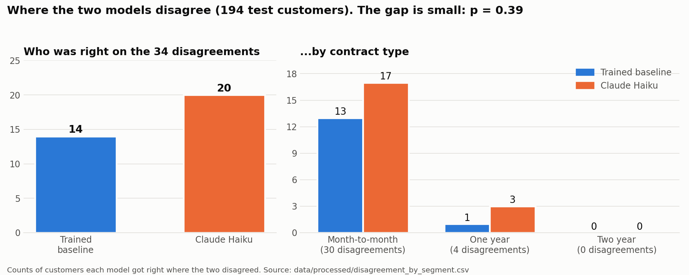

# Churn LLM Comparison

A small, reproducible study of customer churn prediction using the Telco Customer Churn dataset. It compares a trained logistic-regression baseline with Claude Haiku used zero-shot on natural-language summaries of customer records.

**In short:** I compared and trained logistic regression model with Claude Haiku (given no training) on 194 telecom customers. They performed about the same (accuracy 0.742 vs. 0.773, not a meaningful gap), but they made different mistakes. The more useful part is where they disagree and whether the AI's written reasons hold up.

## Problem statement

The project asks whether a zero-shot large language model can substitute for a conventional trained model on a structured prediction task: predict whether a customer will churn (`Yes` or `No`) from the same held-out customer attributes used by the baseline.

The comparison is not just about which model scores higher. It also asks whether the LLM's short, stated rationale is consistent with the profile and whether it holds up when predictions are wrong. Agreement, disagreements, segment-level results, and examples of correct and incorrect reasoning should be examined alongside aggregate metrics. Generated rationales are explanations to inspect, not proof of the model's internal reasoning or causal evidence.

## Dataset

The input is the Telco Customer Churn CSV stored locally at `data/raw/WA_Fn-UseC_-Telco-Customer-Churn.csv`. The inspected file has 7,043 rows and 21 columns. It includes customer attributes for contract, tenure, services, payment method, and charges; `Churn` is the binary target and `customerID` is an identifier, not a predictive feature.

`TotalCharges` is converted to numeric with invalid/blank values coerced to missing values. The baseline preprocessing pipeline median-imputes numeric features using training data. Raw data is excluded from Git; obtain and place the dataset locally before running the notebooks.

Source: IBM's sample Telco Customer Churn dataset, as published on Kaggle (https://www.kaggle.com/datasets/blastchar/telco-customer-churn). This is a public sample dataset with no real customers.

## Method

### Trained baseline

- A logistic-regression classifier with `class_weight="balanced"`.
- An 80/20 train/test split stratified by `Churn`, with `random_state=42`.
- Numeric features are median-imputed and standardized; categorical features, including the low-cardinality `SeniorCitizen` field, are imputed and one-hot encoded.
- Evaluation uses accuracy, precision, recall, F1, and a confusion matrix. Baseline probabilities are saved with held-out predictions.

### Zero-shot LLM

- Claude Haiku receives a compact, natural-language customer summary and is asked for a `Yes`/`No` prediction with one short reason. It is not fine-tuned on this dataset.
- Customer IDs, target labels, and baseline outputs are kept out of the LLM prompt and joined locally for evaluation.
- The workflow is staged: validate summaries and response parsing, then run a small live test, review it, and only then opt into the 200-row test-set sample (`random_state=42`). API calls incur usage costs. A separate 20–30-row Sonnet side-sample is available as an optional experiment.
- Compare models on the same valid rows using standard classification metrics, prediction agreement, disagreement examples, and breakdowns by contract type, tenure bucket (`0–12`, `13–24`, `25–48`, and `49+` months), and monthly-charge quartile.
- An optional cost-sensitive score assigns a false negative (missed churner) five times the cost of a false positive. Review error counts as well as the normalized score.

## Reproduce

1. Create/select a Python environment and install the dependencies from `requirements.txt`.
2. Place the source CSV in `data/raw/WA_Fn-UseC_-Telco-Customer-Churn.csv`.
3. Run `notebooks/01_load_and_inspect.ipynb` from top to bottom to inspect and clean the data, explore churn patterns, and train/evaluate the baseline. This writes `data/processed/baseline_predictions.csv`.
4. For the LLM experiment, make sure the local `.env` contains `ANTHROPIC_API_KEY`. `.env` is ignored by Git; never commit it or put the key in a notebook. `ANTHROPIC_MODEL` can select the configured Haiku model.
5. Run `notebooks/02_haiku_churn_pilot.ipynb` cell by cell so you can review API-call cells before executing them. It contains an 8-row JSON-format pilot and a separate three-row natural-language-summary test; both make billable requests. Inspect the outputs, then explicitly enable the 200-row batch only after a pilot succeeds and billing is available. The comparison section reads `data/processed/llm_predictions.csv` when it exists.
6. After predictions are available, rerun the comparison section to create the merged table and segment reports. See `data/processed/` for generated artifacts. Do not treat failed API rows as valid classifications.

The notebook uses sequential API calls and records response errors. API credits and model availability are controlled by Anthropic and may change; a valid key alone does not guarantee available usage balance.

## Findings

**Setup:** Logistic regression (trained, class-balanced) vs. Claude Haiku (zero-shot, no training)
on the same 194 test customers. Haiku returned a usable answer for 194 of 200 sampled rows;
6 were excluded because they did not follow the required answer format.

| Measure (same 194 customers) | Logistic regression | Claude Haiku |
|---|---|---|
| Accuracy | 0.742 | 0.773 |
| Precision | 0.525 | 0.569 |
| Recall | 0.778 | 0.759 |
| F1 | 0.627 | 0.651 |
| Missed churners / false alarms | 12 / 38 | 13 / 31 |
| Cost-weighted score (miss = 5, false alarm = 1) | 0.761 | 0.766 |

Baseline on the full test set(1,409 customers): accuracy (0.737), precision (0.503), recall (0.783), F1 (0.613). The 194 customer table above uses only the customers Haiku also answered, so the two models are compared fairly. The 6 rows Haiku answered in the wrong format have no prediction and are excluded (in `llm_predictions.csv`their `llm_reason`column holds the error message). The optional Sonnet side-sample was not run.



**What I found**

- The models agree on 160 of 194 customers (82.5%). The interesting part is the 34 where they differ.
- On those 34, Haiku was right 20 times and the baseline 14. A sign test gives p ≈ 0.39, so this is not statistically meaningful.
- 30 of the 34 disagreements were month-to-month customers. The two-year-contract group had none.
- In 7 of Haiku's written reasons it cited "no internet service" as a sign of churn risk, always together with month-to-month contracts and short tenure. 5 of those 7 customers actually stayed. The baseline's coefficients do not treat "no internet service" as a churn driver.
- Both models missed 8 churners who looked stable (long tenure, autopay, add-ons), which is a limit of the data.
- Haiku behaves a lot like a tenure rule. It predicted churn for 91% of customers with 12 months or less (47% actually left) but only 16% of customers with more than 12 months (20% actually left). It was more accurate than the baseline on longer-tenure customers (86% vs 78%) and less accurate on newer ones (56% vs 64%).

**Reasoning review (5 selected examples):** I read five of Haiku's written reasons against the customers' actual records, choosing cases where the two models were right or wrong in different combinations. In all five, the facts Haiku quoted were true. The logic held up in one (a customer with long tenure, tech support and automatic payment). In the other four, the reason was only partly sound: two treated "no internet service" as a churn risk, although in this dataset those customers leave only 7.4% of the time, and two let long tenure outweigh several risk factors (fiber optic, electronic-check payment, high monthly charges). One reason was sensible but the customer left anyway, and one prediction was right for a flawed reason, so a correct prediction does not mean a sound explanation. Five hand-picked examples illustrate patterns but do not represent all 194 customers.

**Conclusion:** On this sample a zero-shot LLM performed comparably to a trained model,
with different failure patterns. Its written reasons are plausible text, not proof of what
drove the prediction, so they need auditing.

**Limitations:** small sample (194 rows, 54 churners), one run, one prompt, one LLM, cost weights are an assumption, and the reasoning review covers only 5 hand-picked examples that I checked myself against the data, so it is illustrative, not representative

## Related work

Describing a table row in plain language so a language can classify it comes from TabLLM (Hegselmann et al., 2023, https://arxiv.org/abs/2210.10723). This project applies a similar row-to-sentence idea to customer churn, compares it with a trained baseline, and examines the model's stated reasons. 

The same IBM Telco dataset was analyzed by Dou (2023), who used linear regression to predict
a churn score and found that longer tenure and longer contracts were associated with lower
churn scores, and higher monthly charges with higher ones, which is consistent with the
patterns in this project. That model explained only about 10% of the variation (R-squared =
0.098), and the author noted that payment method, tech support and online security were not
considered. In this project's data, payment method separated customers sharply: 45% of
electronic-check customers left, against 15% of credit-card autopay customers. A 2024 review
by Anderson lists contract length, charges, tenure and service quality as common churn
predictors. A study of Korean mobile customers (Ahn, Han & Lee) reported that call
quality-related factors influenced churn, which shows that drivers differ by market.

**References**
- Dou, Y. (2023). Customer Churn Prediction: An Empirical Research of Telecommunications
Service Provider in the United States. DAML 2023, SciTePress, 509-514.
https://scitepress.org/PublishedPapers/2023/128020
- Hegselmann, S. et al. (2023). TabLLM: Few-shot Classification of Tabular Data with Large
Language Models. https://arxiv.org/abs/2210.10723
- Ahn, J.-H., Han, S.-P., & Lee, Y.-S. Customer churn analysis: Churn determinants and
mediation effects of partial defection in the Korean mobile telecommunications service
industry. Telecommunications Policy, 30(10-11), 552-568.
https://ideas.repec.org/a/eee/telpol/v30yi10-11p552-568.html
- Anderson, D. (2024). Predictive Modeling of Customer Churn in Telecommunication Companies
in USA. Journal of Statistics and Actuarial Research, 8(2).
https://ideas.repec.org/a/bdu/ojjsar/v8y2024i2id2762.html

## Project layout

```text
churn-llm-comparison/
├── data/
│   ├── processed/       # Baseline and experiment outputs
│   └── raw/             # Local source data (gitignored)
├── documentation/       # Project log
├── notebooks/           # Inspection, baseline, and LLM experiment notebooks
├── outputs/             # Charts used in the README
├── .env.example         # Local configuration template
└── requirements.txt
```
